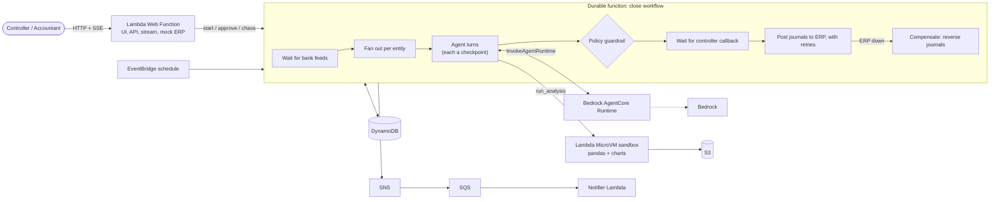

# Close Copilot: demo plan (re:Invent 2026 video, ~4 min)

Month-end financial close with an AI agent team. Fictional company: **Northwind Group**, three entities (US, DE, UK).
Replaces the procurement scenario; reuses the durable workflow, AgentCore runtime pattern, SSE streaming and saga code.

## Why this stands out from the AWS samples

The AWS samples (PriorAuthorization, FraudDetection, OrderProcessing, MicroVM sandboxes) are backend only and
only show the happy path. This demo adds:

1. A real **Lambda web function** UI: close dashboard, live agent trace and charts streamed over SSE.
2. A **MicroVM sandbox that is essential**: the reconciler agent writes and runs pandas against the real ledger and bank files.
3. **Live failure injection** (only possible locally): kill the sandbox mid-run, take the ERP down mid-posting, restart LocalStack.

## Storyline

"Finance closes the books in 5 days. Northwind does it before lunch, with a full audit trail."

| # | Beat | Length | What the viewer sees |
| --- | --- | --- | --- |
| 1 | Problem | 15s | Title card: 5 day close, 3 entities, spreadsheets |
| 2 | Kickoff | 20s | EventBridge schedule starts the October close. Dashboard shows 3 entities, checklist, stepper |
| 3 | Late feed | 20s | The DE bank feed has not arrived. Entity DE shows "waiting" (durable wait, zero compute). The feed lands in S3 and it resumes |
| 4 | Agent reconciliation | 55s | Supervisor fans out one reconciler per entity. Each writes pandas, runs it in the MicroVM, and streams code cells, a match-rate chart and a list of unmatched items. Variance explainer drafts reasons |
| 5 | Guardrail | 25s | The drafter proposes a journal entry to a restricted account. The model says fine, policy says blocked (SoD and account rules). Rules win |
| 6 | Human in the loop | 35s | Controller view: variance chart, drafted journals, agent rationale. Approves. Execution had been paused at zero compute |
| 7 | Chaos | 50s | Kill the sandbox mid-run: retried on a fresh MicroVM, finished LLM turns are not re-billed. Then ERP goes down mid-posting: retries, then the saga reverses the posted journal entries |
| 8 | Close | 20s | Audit tab, "all local, no AWS account, runs in CI". Restart LocalStack with state: the pending close resumes |

## Architecture (three layers)

- **Experience**: Lambda web function (Node.js HTTP server): dashboard, controller view, `/api/stream` SSE, approve/reject, chaos endpoints, mock ERP endpoint, presigned uploads.
- **Intelligence**: Bedrock AgentCore Runtime hosts the agent brain, one call per turn, with roles: supervisor, reconciler, variance explainer, journal drafter. Models via Bedrock.
- **Reliability**: one durable function per close. Checkpoint per LLM turn and tool call. `map` fan-out per entity, wait for late feeds, callback for controller sign-off, retries on the ERP post, saga to reverse journals.
- **Sandbox**: Lambda MicroVM running a small Python executor (pandas, matplotlib). Code in, stdout and chart PNG (to S3) out.
- **Plumbing**: EventBridge (scheduled kickoff), S3 (feeds, charts, close package), DynamoDB (ledger, journals, audit, close state), SNS/SQS/notifier Lambda (notifications).

## UI (dark/light toggle already done)

- **Close dashboard**: entities, checklist progress, match-rate cards, variance chart.
- **Live stepper** per entity: feed, reconcile, explain, draft, approve, post.
- **Agent notebook pane**: reasoning, tool cards, code cells, chart output, streaming.
- **Controller view**: approval inbox with evidence. Role switcher: Accountant / Controller.
- **Chaos drawer**: kill sandbox, ERP down, delay a feed, restart LocalStack.
- **Audit tab**: every model output, rule result, journal and human decision.
- Fixed seed data so every take is identical.

## Build phases

1. **Spike**: MicroVM create/invoke on LocalStack with a pandas executor image. Go/no-go for the sandbox; fallback is a Lambda container sandbox.
2. **Data and domain**: seed ledger, bank feeds, subledgers for 3 entities with planted discrepancies (timing differences, duplicates, a FX mismatch). Policy rules, account restrictions, materiality threshold.
3. **Workflow**: swap procurement for close: feed wait, per-entity map, agent roles, journal drafting, ERP post, saga. Reuse AgentCore runtime and SSE.
4. **Sandbox tool**: `run_analysis`, chart to S3, code cells streamed to the UI.
5. **UI**: dashboard, stepper, notebook pane, role switcher, chaos drawer, audit tab.
6. **Demo ops**: chaos hooks, `make demo-reset`, scripted scenario runner for retakes, deterministic planner as default (real model as optional live take).
7. **Docs**: README, diagram, shot list, update integration tests and CI workflow.

## Decisions made / open

- AgentCore: Runtime only (no Gateway, Memory, Identity).
- Open: keep `AGENT_MODEL_MODE` default as deterministic planner for takes? (assumed yes)
- Open: three entities fixed at US, DE, UK with USD, EUR, GBP (FX mismatch is a good planted variance).
