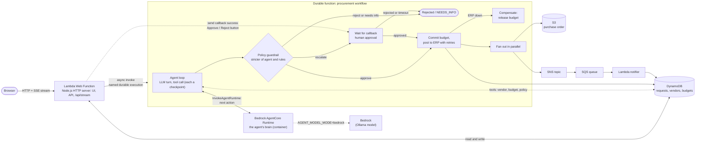

# Procurement Copilot (re:Invent 2026 lightning talk)

An enterprise purchase-request app where an **AI agent** reviews requests inside a
**Lambda durable function**. Everything runs locally on LocalStack.

## Talk points

- **AgentCore + durable**: the agent's brain is a Bedrock AgentCore Runtime, the durable function owns the loop, tools and side effects.
- **Streaming**: the web function pushes the agent trace and durable timeline to the browser over Server-Sent Events.
- **Durable agent loop**: every LLM turn and tool call is a checkpointed step, so a
  crash or a day-long approval never re-runs (or re-bills) finished LLM calls.
- **AI proposes, policy disposes**: the agent's verdict is compared with hard rules in code; the stricter one wins.
- **Human in the loop**: escalated requests pause on a durable callback with zero compute.
- **Saga**: if the ERP stays down after approval, the budget commit is rolled back.
- **Idempotency**: the request id is the durable execution name.

## Run

Needs LocalStack Pro (durable functions, Lambda Web Functions, Bedrock AgentCore), Docker, Node.js and Python 3.13+.
Start LocalStack with AgentCore enabled:

    docker run -d --name localstack -p 4566:4566 \
      -e LOCALSTACK_AUTH_TOKEN -e ENABLE_BEDROCK_AGENTCORE=1 \
      -v /var/run/docker.sock:/var/run/docker.sock localstack/localstack-pro

Then:

    make deploy    # builds, creates the AgentCore runtime, deploys via CloudFormation, seeds data
    make url       # open this in a browser
    make test      # integration tests

The agent's brain (`functions/agent`) runs as a Bedrock AgentCore Runtime from a locally built
Docker image; the durable function calls `InvokeAgentRuntime` once per agent turn.

| Variable | Effect |
| --- | --- |
| `MODEL_MODE=rules` | skip AgentCore, use the in-function planner |
| `AGENT_MODEL_MODE=bedrock` | the runtime asks a model through Bedrock (LocalStack: Ollama) and falls back to the rule planner if the output is unusable (default: `rules`) |
| `LOCALSTACK_ENDPOINT` | target another instance, e.g. `http://localhost.localstack.cloud:4567` |

Running LocalStack on a different port (say 4567)? Set `LOCALSTACK_ENDPOINT` for `make deploy`, `make url`
and `make test`. Start the container with `GATEWAY_LISTEN=0.0.0.0:4567`,
`LOCALSTACK_HOST=localhost.localstack.cloud:4567`, and the web function's origin in
`EXTRA_CORS_ALLOWED_ORIGINS` (`make url` prints it), otherwise LocalStack's CORS check blocks the UI's API calls.

## Demo script (use the example buttons in the UI)

1. **auto-approve**: $12k laptops from Dell. Watch the agent call lookup_vendor, check_budget, check_policy, then the PO is issued.
2. Same request with **flaky ERP** ticked: two timeouts with backoff, still one function.
3. **needs human**: $38k Cisco switches. Execution pauses; click Approve. Reject instead to see the rejection path.
4. **blocked vendor** and **over limit**: rejected by policy even if the model would approve.
   **incomplete** (no vendor or amount) ends in NEEDS_INFO instead of a rejection.
5. Restart LocalStack with persistence while a request waits for approval; it resumes.

## Notes

- The web function is a Lambda Web Function: a plain Node.js `http.createServer` app (`nodejs24.x`), not an event handler.
- By default the agent runtime uses a deterministic planner so the stage demo is fast and repeatable.
  With `AGENT_MODEL_MODE=bedrock` the model replies with JSON actions; if its output is unparseable the
  runtime falls back to the planner and the source shows up in the agent trace.
- If AgentCore is unreachable, the workflow falls back to the in-function planner and the trace says so.
