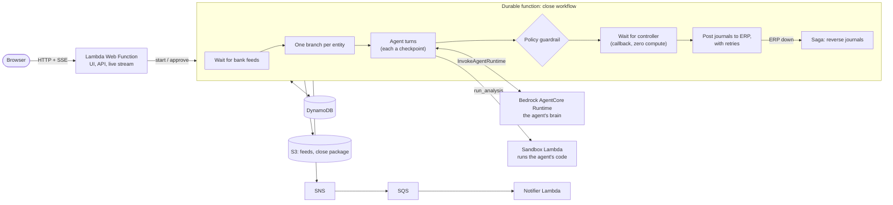

# Finance Closing Copilot (re:Invent 2026 demo)

**AI agents close the books. Policy has the last word. People sign off.**

A month-end close for three legal entities (US, DE, UK), run by AI agents inside an
AWS Lambda **durable function**, with a **Lambda web function** UI. Everything runs locally on LocalStack.

The UI is one screen made for recording: four big stages, one card per entity, big buttons, a live
architecture diagram that lights up the services working at each step (with a one-line explanation),
and a terminal that tails the Lambda logs from CloudWatch. The right side ("Behind the scenes") is the
infrastructure, the left side is the app.

The story in four steps:

1. **Collect**: bank feeds come in. One is late, so that entity pauses at zero compute.
2. **Reconcile**: one AI agent per entity (Bedrock AgentCore) matches the ledger against the bank. The code the agent runs executes in an isolated sandbox Lambda.
3. **Approve**: a policy guardrail checks the agents' journals (the stricter of agent and rules wins), then a controller signs off through a durable callback.
4. **Post**: journals go to the ERP with retries. If the ERP stays down, a saga reverses what was posted.

## Run

Needs LocalStack Pro (durable functions, Lambda Web Functions, AgentCore), Docker, Node.js and Python 3.13+.
The `localstack/localstack-pro:dev` image is recommended for now: it routes DNS inside Lambda Web Function
containers, which the live infra view relies on.

    docker run -d --name localstack -p 4566:4566 \
      -e LOCALSTACK_AUTH_TOKEN -e ENABLE_BEDROCK_AGENTCORE=1 \
      -v /var/run/docker.sock:/var/run/docker.sock localstack/localstack-pro:dev

    make deploy    # build, create the AgentCore runtime, deploy via CloudFormation, seed data
    make open      # open the UI (the endpoint id is random per deploy; `make url` prints it)
    make test      # integration tests (one per demo beat)
    make reset     # back to a clean state: no runs, no chaos, DE bank feed held back again

On a different port (say 4567): start the container with `-p 4567:4567 -e GATEWAY_LISTEN=0.0.0.0:4567
-e LOCALSTACK_HOST=localhost.localstack.cloud:4567` and set `LOCALSTACK_ENDPOINT=http://localhost.localstack.cloud:4567`
for the make targets.

## Demo script

Pressing **Start** always begins from a clean slate (old postings cleared, DE bank feed held back again,
running closes stopped), so every take plays the same. The chaos switches keep their setting.

1. **Start the October close.** US and UK reconcile, each card shows what its agent is doing (thinking, loading feeds, running code in the sandbox). DE stops and says its bank feed is late.
2. **Deliver the DE bank feed.** DE resumes. Each entity shows its match rate.
3. **Policy overrides the agent.** One drafted journal books an unexplained receipt to Retained Earnings (restricted). Policy blocks it and the controller has to sign off.
4. **Approve.** The books close.
5. **Chaos (Simulation).** Turn on "Kill the sandbox" (the agent's code is retried on a fresh sandbox, finished agent turns are not repeated) or "ERP down" (posting fails, the saga rolls everything back).

## How the agent thinks

| `AGENT_MODEL_MODE` | Effect |
| --- | --- |
| `rules` (default) | A deterministic planner inside the AgentCore runtime. No LLM: fast and repeatable for recording |
| `bedrock` | The runtime asks a model through Bedrock (LocalStack: Ollama) |
| `openrouter` | The runtime asks any OpenRouter model. Needs `OPENROUTER_API_KEY`, optional `OPENROUTER_MODEL` |

In `rules` mode the agent pauses a little on each turn (2.5 s by default, slightly different per entity) so the UI shows it working. Change it with `make reset DEMO_THINK_SECONDS=0` (or any number of seconds). The integration tests turn it off.

A model mode falls back to the rule planner when the model's output is not usable, and the trace says so.
`make deploy AGENT_MODEL_MODE=openrouter OPENROUTER_API_KEY=...` (the key becomes an environment variable
of the AgentCore runtime). `MODEL_MODE=rules` skips AgentCore entirely and plans inside the workflow.

## Notes

- The web function is a Lambda Web Function: a plain Node.js `http.createServer` app (`nodejs24.x`), not an event handler. It streams state over Server-Sent Events.
- The sandbox is a separate, locked-down Lambda (read-only access to the feed files). It has the interface of a Lambda MicroVM (code and inputs in, output out) so it can move to MicroVMs once LocalStack supports them.
- Seed data is deterministic (`scripts/seed.py`) with planted discrepancies, so every take is identical.
- One Server-Sent Events connection per browser tab (`/api/stream`) carries both the state snapshots and the Lambda logs, because browsers allow only 6 HTTP/1.1 connections per host. Background tabs close their stream and reconnect when shown.
- `/api/logs` (Lambda logs alone) and `/api/infra` (a live inventory of the LocalStack resources) are available for `curl` and the tests, but the UI does not use them.
- Every update to a run goes through one helper that never creates a row, so a leftover execution cannot bring a reset run back.
- `make reset` is the full wipe. Docker needs free disk: the demo's containers and images are small, but parallel test suites that pull large images can fill the Docker VM and stall everything (sandbox, logs).
