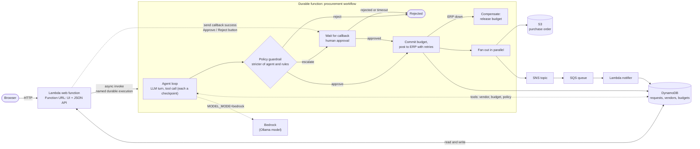

# Procurement Copilot (re:Invent 2026 lightning talk)

An enterprise purchase-request app where an **AI agent** reviews requests inside a
**Lambda durable function**. Everything runs locally on LocalStack.

## Talk points

- **Durable agent loop**: every LLM turn and tool call is a checkpointed step, so a
  crash or a day-long approval never re-runs (or re-bills) finished LLM calls.
- **AI proposes, policy disposes**: the agent's verdict is compared with hard rules in code; the stricter one wins.
- **Human in the loop**: escalated requests pause on a durable callback with zero compute.
- **Saga**: if the ERP stays down after approval, the budget commit is rolled back.
- **Idempotency**: the request id is the durable execution name.

## Run

    make deploy                      # build, deploy via CloudFormation, seed vendors and budgets
    make url                         # open in a browser
    MODEL_MODE=bedrock make deploy   # use LocalStack's Bedrock (Ollama) instead of the rule-based planner

Point at a specific instance: `LOCALSTACK_ENDPOINT=http://localhost:4566 make deploy`.
Needs LocalStack 2026.08+ with a Pro auth token (durable functions, Bedrock).

## Demo script (use the example buttons in the UI)

1. **auto-approve**: $12k laptops from Dell. Watch the agent call lookup_vendor, check_budget, check_policy, then the PO is issued.
2. Same request with **flaky ERP** ticked: two timeouts with backoff, still one function.
3. **needs human**: $38k Cisco switches. Execution pauses; click Approve. Reject instead to see the rejection path.
4. **blocked vendor** and **over limit**: rejected by policy even if the model would approve.
5. Restart LocalStack with persistence while a request waits for approval; it resumes.

## Notes

- `MODEL_MODE=rules` (default) uses a deterministic planner so the stage demo is
  fast and repeatable. In `bedrock` mode the model replies with JSON actions; if
  its output is unparseable the step falls back to the planner and says so in the trace.
